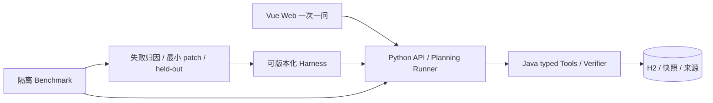

# CoursePilot-Evo

一个帮助学生核对学业进度、了解课程与教师、表达选课偏好并比较方案的学业规划项目。支持课程咨询对话与逐步引导，覆盖高绩点、工作量、签到、兴趣、指定教师、职业与时间等组合目标。课程事实和时间由 Java 核验，Agent 负责理解、规划与解释。

**当前状态：虚构资料下的学生主流程已完成三端联调。** 可以在网页填写目标和学业记录，由 Python 调用 Java 核对并展示规划结果；指定教师与时间条件的澄清回填也已验证。培养计划可通过本地受限接口导入虚构 XLSX。当前模型默认使用受控假实现，真实培养计划的独立基线、真实班次和模型质量评测仍待完成。运行方法见 [Web 说明](web/README.md)。

## 先看懂项目，再开始开发

先读[团队总览：业务流程、核心对象、模块分工](docs/15-team-baseline-and-batches.md)，再到[个人模块业务说明与 TRD](docs/05-team-and-sub-trds.md)理解完整职责，最后领取[本期业务任务](docs/19-delivery-plan.md)。看板标题是业务交付，接口和实现步骤在卡片里。

上手和维护：[E 模块（学生网页与老师报告）指南](docs/23-web-e-module-guide.md)、[仓库维护手册](docs/24-repo-maintenance.md)。

## 团队进度入口

[开发与验收看板](https://github.com/users/HelicasECoode42/projects/1) · [队员操作说明](docs/18-team-progress-guide.md) · [第五至第八周排期草案（待核对）](docs/19-delivery-plan.md)。仅维护周次；任务和 Bug 使用同一看板，审批证据保留在关联 PR。

## 从这里开始

| 你要做什么 | 入口 |
| --- | --- |
| 看学生体验 | [HTML 示例](demo/coursepilot-guided-demo.html)及[交接说明](demo/README.md)，下载后用浏览器打开 |
| 看学生页面与数据流转 | [页面、接口与数据流转](docs/27-student-experience-and-data-flow.md)：学校导入、学分来源、完整引导、推荐和方案编辑 |
| 看 AI 对话与确认操作 | [对话接口](docs/29-advice-chat-contract.md)与[验收记录](docs/checkpoints/advice-chat.md)：真实模型咨询、课程依据、采用偏好与进入规划 |
| 启动 E1 学生页面 | [Vue Web 说明](web/README.md)：真实服务模式、虚构演示模式、检查方式与当前边界 |
| 看项目怎么运转、每人最终交什么 | [团队业务总览](docs/15-team-baseline-and-batches.md)、[模块阅读入口](docs/05-team-and-sub-trds.md) |
| 了解用户需要 | [PRD](docs/02-prd.md)、[选课需求与资料研究](docs/14-student-choice-research-and-ux.md) |
| 实现接口 | [总体 TRD](docs/03-trd.md)、[行为契约](docs/04-infrastructure-workflow.md)、[OpenAPI/Schema](contracts/README.md) |
| 找班次资料、理解它怎么抓取 | [公开历史数据与采集说明](docs/09-browser-adapter.md)：SHUOSC 历史 JSON、抓取流程、字段差异和模块交接 |
| 看自己的完整模块职责 | [A 数据](docs/trd/a-data.md)、[B Java](docs/trd/b-verifier.md)、[C Agent](docs/trd/c-agent.md)、[D RSI](docs/trd/d-benchmark-rsi.md)、[E Web](docs/trd/e-web-integration.md) |
| 提交与 debug | [工程规范](docs/16-engineering-and-debugging.md)、[GitHub 协作](docs/12-github-collaboration.md)、[PR 模板](.github/pull_request_template.md) |
| E1 实施方案与任务进度 | [引导页面与披露自查方案](docs/20-e1-and-disclosure-implementation.md)、[Web任务核对记录](docs/21-web-task-status.md) |
| 填志愿与账号 | [人员表模板](docs/team/team-signup-template.csv)，导入金山表格；填写后的表不要提交公开仓库 |
| 看图与实验 | [Mermaid 图](docs/diagrams/README.md)、[Benchmark 协议](docs/07-benchmark-protocol.md) |

## 架构与目录



- `contracts/`：字段真源、OpenAPI、JSON Schema、正反例。
- `java-environment/`：培养计划导入、学业核对、课程和班次查询及方案核验。
- `agent-runtime/`：唯一 Planning Runner、Python 网关和运行 Harness。
- `benchmark/`、`evo-harness/`：案例、合成运行检查及待完成的评测和策略改进。
- `web/`：Vue 学生页面，包含目标引导、学业资料、教师比较和规划结果；`demo/` 为独立 HTML 示例。
- `docs/`：PRD/TRD、开发规范、学习资料与设计图。
- `scripts/`、`.github/`：契约、自查、模块检查和 PR/CI 规范。

## 仓库检查

推荐用 [uv](https://docs.astral.sh/uv/) 配环境，依赖由 `pyproject.toml` 声明、`uv.lock` 锁定：

```bash
uv sync --group dev
uv run python scripts/check_contracts.py
uv run python scripts/self_check.py
uv run python scripts/check_modules.py
```

没有 uv 时用标准库 venv，效果相同：

```bash
python3 -m venv .venv
. .venv/bin/activate
python -m pip install -r requirements-dev.txt
python scripts/check_contracts.py
python scripts/self_check.py
python scripts/check_modules.py
```

`requirements-dev.txt` 由 `uv export --only-group dev --no-hashes --no-emit-project -o requirements-dev.txt` 从锁文件生成，供 CI 和不用 uv 的人使用；改依赖请改 `pyproject.toml` 后重跑 `uv lock` 和该导出命令，不要手工编辑这两个文件。

各模块有独立测试入口；整套服务的启动和模拟模式见 [Web README](web/README.md)。

运行前端 E1：

```bash
cd web
npm ci
npm run dev
```

真实模式默认连接 `http://127.0.0.1:8000`；服务地址可用 `VITE_API_BASE_URL` 配置。`VITE_COURSEPILOT_MODE=simulation` 使用虚构资料连接本地服务，`fixture` 使用固定页面示例。版本、脚本和限制见 [Web README](web/README.md)。

## 数据与信任边界

培养计划导入器接收标准化 `.xlsx`；当前发布入口用于本地虚构工作簿，原始文件不公开提交。班次已有 [SHUOSC 公开历史数据](docs/09-browser-adapter.md)，当前学期教务快照仍未验证。真实时间缺失、解析未知或来源未核验时显示 UNKNOWN；评价注明教师、修读学期和来源。

学生在官方系统自行选课；项目不持有教务凭据、不执行选课提交。公开仓库排除原始资料、个人成绩、密钥、私有 Trace 和独立验收答案。具体代码与日志要求见工程规范。

自进化参考 System 1/2 与 task-group 思路，限定运行 Harness 文本/策略 patch；固定模型、工具和预算，经隔离 held-out 决定晋级/回滚。两轮流程和少 token 且不降质是验收/实验目标，结果须实测。

接口与跨模块一致性检查见 [复核记录](docs/17-contract-review.md)。
