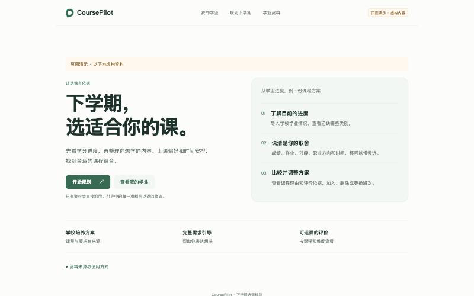
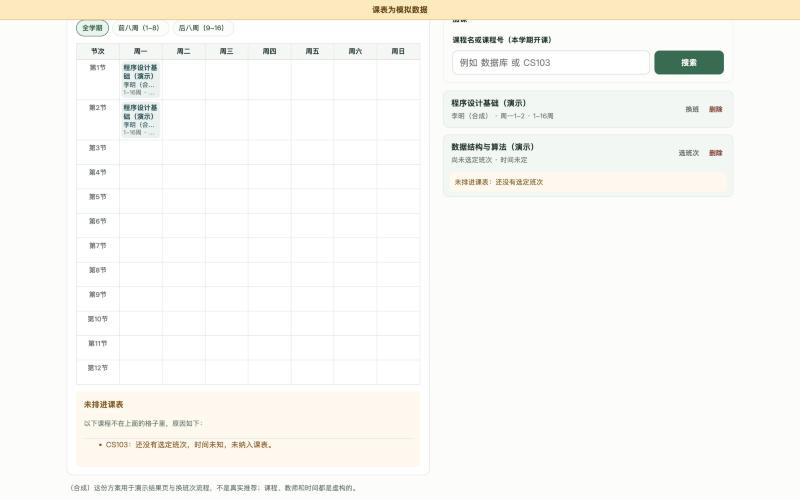
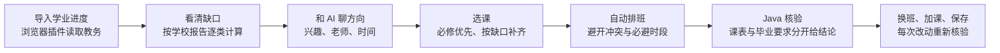
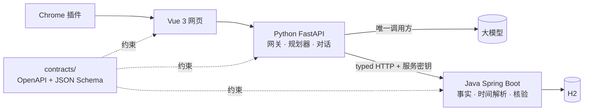

<p align="center">
  
</p>

<p align="center">
  <b>下学期选课规划助手：读懂你的学业缺口，排出能上的课表，并且每一条结论都能核验。</b>
</p>

<p align="center">
  <a href="https://github.com/HelicasECoode42/CoursePilot-Evo/actions/workflows/project-checks.yml"></a>
  
  
  
  
  
  
</p>

<p align="center">
  
  
</p>
<p align="center"><sub>截图均为虚构演示数据</sub></p>

---

## 它解决什么问题

选课时，学生要同时对照四样东西：培养方案还差哪些学分、这学期开了哪些班、时间冲不冲突、老师口碑怎么样。这些信息分散在教务系统、课表 PDF 和评价册里。CoursePilot 把它们放进一条流程：



## 核心能力

| 能力 | 说明 |
|---|---|
| 学业进度同步 | 插件从教务系统读取学业情况（类别树和课程状态），各类缺口以学校报告为准；在读课程不计学分 |
| 真实课表 | 导入学校公布的 2026-2027 秋季课表（6431 个教学班），上课时间由 Java 统一解析，经人工抽查核验后才标为"已核验" |
| 智能规划 | 只推荐本学期开设、未修过、不在读的课程；专业必修课优先；缺口落到具体子类；自动挑选不冲突的班次 |
| 可核验结论 | 结论分为"本学期课表"和"毕业要求"两项；未知永远不算通过；每条结论都能追溯到依据 |
| AI 问答 | 结合学业缺口和课程事实回答"我该往哪个方向选"；模型只能从候选课程中选择，输出必须通过格式校验 |
| 评价参考 | 选课评价按老师加课程匹配，逐条注明学期；对不上的不硬凑 |
| 结果编辑 | 一周课表可切换前八周/后八周；支持换班、加课、删课，保存到本机或打印 |

## 架构



- **职责分离**：网页只调用 Python；Python 只通过带类型的接口向 Java 取事实；Java 不调用模型。学分、冲突这类可复核的结论只由 Java 给出。
- **契约先行**：所有跨模块字段都定义在 `contracts/` 中，CI 会校验正反例。
- **Java 做了什么**：培养方案 Excel 导入、课表导入与重新解析、全系统唯一的时间解析器、人工核验留痕、学业核对、方案核验、鉴权与数据隔离。详见 **[Java 核验服务说明](docs/40-java-implementation.md)**（含流程图）。

## 目录

| 目录 | 内容 |
|---|---|
| `java-environment/` | Java 核验服务：导入、查询、学业核对、方案核验（Spring Boot · JPA · H2） |
| `agent-runtime/` | Python 网关与唯一规划器，含模型适配、预算与可版本化的 Harness |
| `web/` | Vue 3 学生页面：学业资料、我的学业、引导、选课、规划结果 |
| `browser-adapter/` | Chrome 插件：读取学校学业情况页面 |
| `contracts/` | 字段真源：OpenAPI、JSON Schema 与正反例 |
| `benchmark/`、`evo-harness/` | 评测案例与运行器；自进化执行器尚待实现 |
| `scripts/`、`integration/` | 检查脚本、数据转换、全栈启动与集成检查 |
| `docs/` | PRD、TRD、设计与验收记录 |

## 快速开始

```bash
uv sync --group dev
uv run python scripts/check_contracts.py
uv run python scripts/self_check.py
uv run python scripts/check_modules.py
```

没有 uv 时：

```bash
python3 -m venv .venv && . .venv/bin/activate
python -m pip install -r requirements-dev.txt
python scripts/check_modules.py
```

只看页面（虚构数据，不需要后端）：

```bash
cd web && npm ci && npm run dev:fixture
```

本机完整运行需要私有配置（服务密钥、模型地址），见 [Web README](web/README.md) 和 `integration/start_stack.py --help`。公网演示脚本是 `scripts/demo_public.sh`。Java 需要 JDK 21 或更高版本。

## 质量与安全

- CI 运行四套测试：网页（Vitest）、Python（pytest）、Java（JUnit）、评测（pytest），另加契约校验与仓库自查。
- 服务密钥只放在本机私有文件中；Java 默认只监听本机；按学生隔离数据，访问他人数据返回 404；请求大小有上限。
- 模型额度在调用前预留，并设有全站每日上限。
- 公开仓库不包含原始学校资料、个人成绩、密钥或评测答案。项目不持有教务凭据，也不代替学生提交选课。

## 局限与下一步

- 下学期课表尚未发布，目前用本学期课表作参考，页面上有明确标注。
- 培养方案中有少数规则（如全英语课程要求）需人工确认。
- 回答质量的评测需要人工标注真值，自进化循环（失败归因、最小改动、留出集晋级与回滚）只有设计，代码尚未落地。

<details>
<summary><b>团队协作与文档索引</b></summary>

| 你要做什么 | 入口 |
| --- | --- |
| 理解业务与分工 | [团队总览](docs/15-team-baseline-and-batches.md)、[模块 TRD 入口](docs/05-team-and-sub-trds.md)、[交付计划](docs/19-delivery-plan.md) |
| 各模块 TRD | [A 数据](docs/trd/a-data.md)、[B Java](docs/trd/b-verifier.md)、[C Agent](docs/trd/c-agent.md)、[D 评测](docs/trd/d-benchmark-rsi.md)、[E Web](docs/trd/e-web-integration.md) |
| 页面与数据流 | [学生页面与数据流转](docs/27-student-experience-and-data-flow.md)、[AI 对话接口](docs/29-advice-chat-contract.md) |
| 接口与规范 | [总体 TRD](docs/03-trd.md)、[行为契约](docs/04-infrastructure-workflow.md)、[OpenAPI/Schema](contracts/README.md)、[工程规范](docs/16-engineering-and-debugging.md) |
| 课表与核验 | [课表人工核验指南](docs/37-offering-verification-guide.md)、[Java 核验服务说明](docs/40-java-implementation.md) |
| 协作 | [GitHub 协作](docs/12-github-collaboration.md)、[PR 模板](.github/pull_request_template.md)、[仓库维护](docs/24-repo-maintenance.md)、[看板](https://github.com/users/HelicasECoode42/projects/1) |
| 图与评测 | [Mermaid 图](docs/diagrams/README.md)、[Benchmark 协议](docs/07-benchmark-protocol.md) |
| 体验原型 | [交互式 HTML 示例](demo/coursepilot-guided-demo.html) |

`requirements-dev.txt` 由 `uv export --only-group dev --no-hashes --no-emit-project -o requirements-dev.txt` 从锁文件生成；修改依赖请改 `pyproject.toml`，然后重新运行 `uv lock` 和这条导出命令。

</details>
