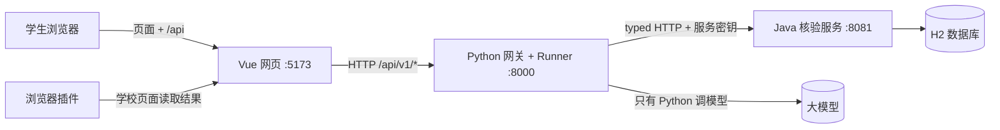
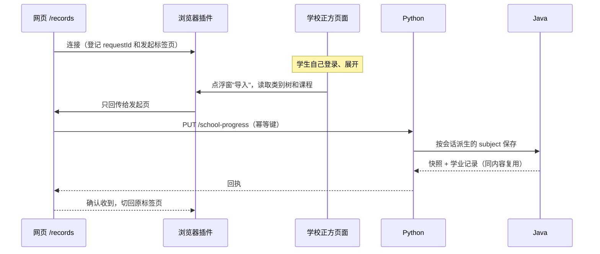
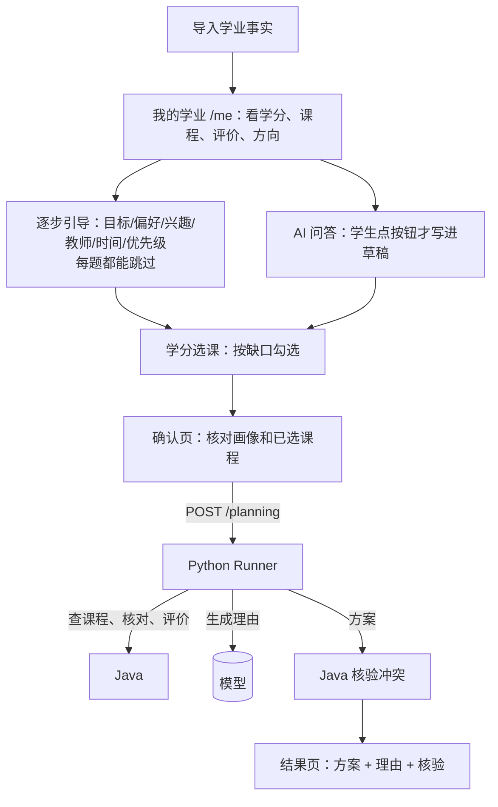
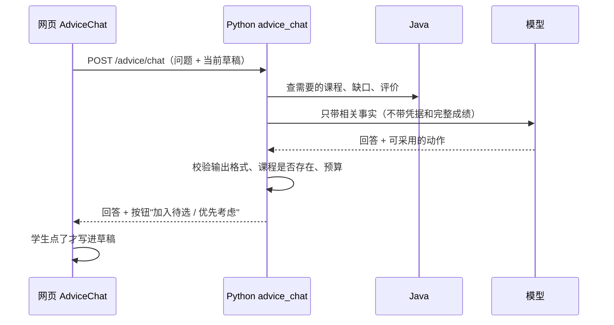
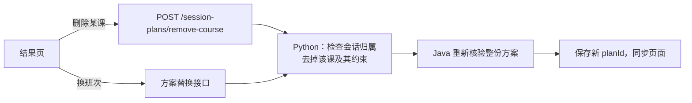

# 仓库现状、模块演变与功能逻辑图（2026-10-30）

依据：git 历史、GitHub（`gh`）、`docs/05`、`docs/26`~`29`、`docs/checkpoints/`。改动行数是 `git log --shortstat` 加总，包含合并提交，只能看个量级。

## 1. GitHub 现状

- 仓库：github.com/HelicasECoode42/CoursePilot-Evo，公开，默认分支 `main`。
- 当前分支 `feat/b-contract-endpoints` 比 `origin/main` 多 35 个提交，**还没推送，也没有 PR**。
- 另有 **73 个文件未提交**：web 37、agent-runtime 17、contracts 7、docs 10、browser-adapter 1、README 1。AI 对话、课程分类、用户画像修复都在里面，**队友现在看不到**。
- PR 共 23 个，其中 2 个还开着：Java 核验（mira-xu）、D3 评测（amorfatiii）。Issue 还开着 11 个。
- **CI：`main` 的定时 integration-checks 从 10-27 到 10-30 连续 4 天失败**，失败原因还没看。

## 2. ABCDE：当初分工 → 现在实际

整合期大致从 10-14 开始，以第一个 integration 提交为准，文档里没写明具体日期。

| 模块 | 当初分工 | 现在实际 | 改动量 |
|---|---|---|---|
| A 导入/来源（JiangYiLin-Q121） | 培养方案、评价等原始资料导入 | 做了 14 个合同示例和 Java 里的 XLSX 导入器，最后一次提交在 10-26；**真正接通的培养方案导入是 E 做的** | 小 |
| B Java 核验（mira-xu） | 存储、学分核对、时间解析、方案核验 | mira-xu 提交了 10 个，主要是核验模板；**整合期的 22 个提交几乎都是 E 写的** | 23 个提交，约 +12.8k 行 |
| C Python 网关（goat-yang / yz） | 唯一 Runner、API 网关 | 基础接口由 C 完成；整合期加了评价、换班、学校进度、AI 对话 | 31 个提交，约 +10.4k 行，整合期占 +6.3k |
| D 评测/演化（amorfatiii） | 题集、评分、自我演化 | 题集和评分骨架都有了，**演化部分基本没做**（evo-harness 只有 1 个提交）；整合期只有 2 个提交 | 13 个提交，约 +2.8k 行 |
| E 网页/集成（HelicasECoode42） | Vue 页面、联调 | **实际扩到全栈统筹**：网页、合同、浏览器插件、Java、Python 和大部分文档 | web 27 个提交，约 +29.9k 行 |

一句话：**整合阶段 B、C 的大量新功能和 A 的导入接通，都是 E 补上的；D 的演化没有落地。**

## 3. 整合期加了或改了哪些业务

| # | 业务点 | 原计划有没有 | 动了哪些模块 | 状态 |
|---|---|---|---|---|
| 1 | 浏览器插件读取学校正方的学业进度 | 原 PRD 只有"导入/补缺入口" | 插件、B、C、E、合同 | 已提交，插件仍有未提交改动 |
| 2 | 培养方案真实导入，按快照查询 | 有，但没接通 | A、B、C、E | 已提交 |
| 3 | 学业记录改成聚合读取，未知不再当 0 分 | 新增 | B、C、E | 已提交 |
| 4 | 教师课程意愿、评价检索、AI 引用评价 | 部分 | A（评价数据）、B、C、E、合同 | 已提交 |
| 5 | 删除课程、在会话里换班次并重新核验 | 新增 | B、C、E、合同 | 已提交 |
| 6 | 开课快照与课表冲突检查，缺快照时判为未知 | 部分 | B、C、合同 | 已提交 |
| 7 | 职业方向接口、一周课表 | 新增 | B、C、E | 已提交 |
| 8 | 网页三页入口与模拟模式 | 新增 | E | 已提交 |
| 9 | AI 对话推荐 `/api/v1/advice/chat` | 新增 | C、E、合同 | **未提交** |
| 10 | 课程分类（course_scope） | 新增 | C | **未提交**；本地缺通识、任选课的完整候选数据 |
| 11 | 用户画像修复（按钮语义、额度提示、确认页显示课程） | 改动 | E | **未提交** |

接口条数（planning 合同里的路径数）：9-30 是 11 条，10-23 是 13 条，10-29 是 14 条，HEAD 是 16 条，工作区是 17 条。

和原设计不一样的地方：`docs/03` 写的是 MySQL 3306、Java 8080，实际用的是 H2 文件库、8081。

## 4. 功能逻辑图

### 4.1 总体分层

### 4.2 学校学业导入

### 4.3 画像收集 → 规划 → 核验

### 4.4 AI 问答

额度：每个会话最多输出 20000 token，大约 9 轮，用完必须刷新重开。限流：5 分钟内最多 10 次。

### 4.5 删课和换班

这一步**不调用模型**。删掉最后一门课后得到空方案，核验结果为 null。

## 5. 建议

1. 先把 73 个未提交改动分批提交，推送后开 PR，否则队友拿不到 AI 对话和画像修复。
2. 查 `main` 上 integration-checks 连续失败的原因。
3. 和 A、B、D 同步：B、C 的整合期代码大多是 E 写的，复核接口时要找原负责人确认；D 的演化如果不做了，要在文档里明确写出来。
