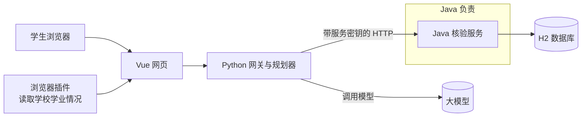
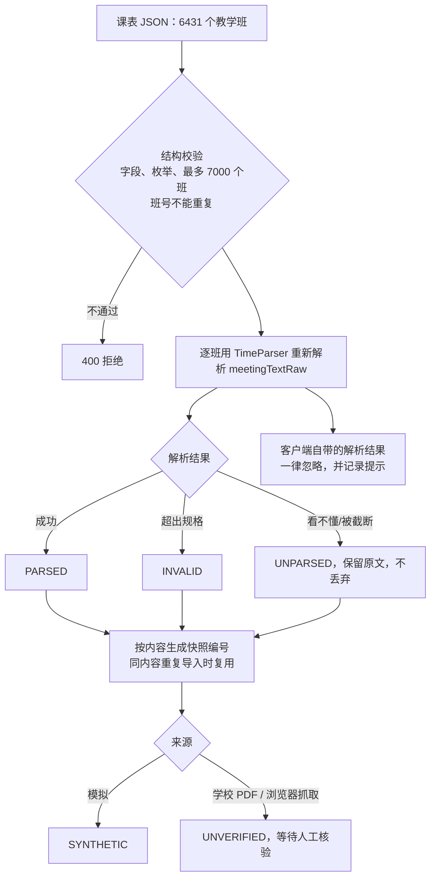
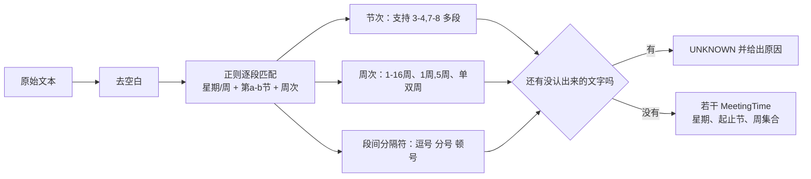
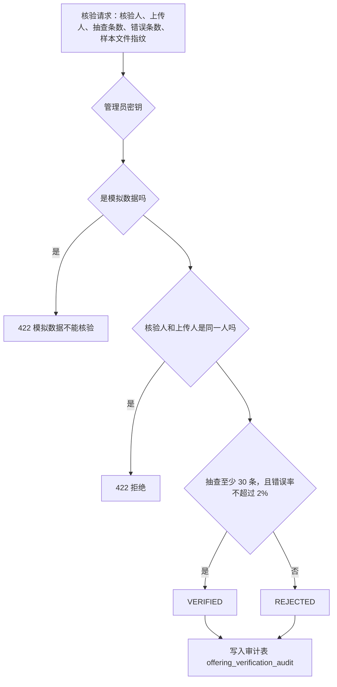
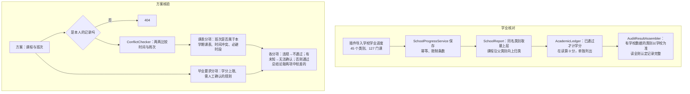

# Java 核验服务做了什么

`java-environment/`：Spring Boot 3.4.1、Java 21、Spring Data JPA、H2 文件库，端口 8081，默认只监听本机。

**一句话**：Java 是整个系统的"事实与规则中心"。课程、课表、学业记录、评价都存在这里；上课时间只在这里解析；学分够不够、时间冲不冲突，只在这里判定。Java 不调用 AI。AI 给出的推荐，最后都要交给 Java 核验。

规模：主代码 96 个类、约 8100 行；测试 28 个文件、约 5700 行、267 个 `@Test`。

## 1. 在整个系统里的位置



- 网页只调用 Python；Python 通过带类型的 HTTP 接口向 Java 取数据、请求核验。
- 每个请求都要带服务密钥 `X-Service-Key` 和学生身份 `X-Subject-Id`。数据按学生隔离，访问别人的数据一律返回 404，不暴露数据是否存在。

## 2. 代码结构

| 包 | 内容 | 代表类 |
|---|---|---|
| `web` | 13 个 Controller、过滤器、统一返回格式、异常处理 | `QueryController`、`PlanValidationController`、`ServiceKeyFilter`、`RequestSizeLimitFilter`、`SubjectGuard`、`ApiExceptionHandler`、`Envelope` |
| `application` | 业务服务与算法 | `TimeParser`、`ConflictChecker`、`PlanValidationService`、`OfferingImportService`、`OfferingVerificationService`、`SchoolProgressService`、`SchoolReport`、`AcademicLedger`、`AuditResultAssembler` |
| `domain` | 领域值对象 | `MeetingTime`、`ConflictResult`、`AuditOutcome` |
| `persistence` | 16 个实体、15 个 Repository | `CurriculumSnapshot`、`CourseOffering`、`SchoolProgressSnapshot`、`OfferingVerificationAudit`、`CurriculumUnmodeledRule` |
| `importer` | 培养方案 Excel 导入器 | `A1WorkbookImporter`、`XlsxInputGuard`、`ImportModels` |

## 3. 接口一览（均在 `/api/v1` 下）

| 类别 | 接口 |
|---|---|
| 查询 | `GET /courses`、`GET /offerings`、`GET /curriculum-snapshots`、`GET /offering-snapshots`、`GET /reviews/search`、`GET /teacher-course-options`、`GET /career-directions` |
| 导入（需管理员密钥） | `POST /curriculum-snapshots/import`（Excel）、`POST /offering-snapshots/import`（课表）、`POST`/`DELETE /reviews/import`（评价） |
| 课表人工核验 | `POST /offering-snapshots/{id}/verification` |
| 学业进度与记录 | `PUT`/`GET /school-progress`、`GET`/`POST /academic-records` |
| 核验 | `POST /requirements/audit`（学业核对）、`POST /plans/validate`（方案核验） |

## 4. 五条核心流程

### 4.1 培养方案导入：Excel 进库

```mermaid
flowchart TD
  A[上传培养方案 .xlsx] --> B{管理员密钥 · 仅本机 · 不超过 10MB}
  B -->|不通过| R1[拒绝]
  B --> C[XlsxInputGuard 安全读取<br/>防压缩炸弹]
  C --> D[A1WorkbookImporter.prepare<br/>识别工作表 · 校验模板标题]
  D --> E[逐行解析课程<br/>课程号、名称、类别、学分、建议学期]
  E --> F[展开课程号区间<br/>01014125~127 展开成 3 门]
  F --> G{学分能确认吗}
  G -->|不能| H[学分记为空，标 CREDITS_UNSPLIT]
  G -->|能| I[正常入库]
  E --> J[说明行分三类：<br/>需人工确认 / 仅说明 / 排除]
  H & I & J --> K[按内容算 SHA-256 幂等键<br/>同一文件重复导入只入库一次]
  K --> L[发布快照，来源标"未核验"]
```

数据清洗规则：
- 占位课程号（如体育 `xx`）记为 `COURSE_CODE_PENDING`，不编造课程号。
- 学分没法拆分的区间，学分留空，不平均分摊。
- "毕业前修一门全英语课"这类规则，系统建模不了就记为"需人工确认"，不会当作已经满足。

### 4.2 课表导入：不信任客户端，Java 自己解析时间



### 4.3 TimeParser：全系统唯一的时间解析器

输入示例：`星期一第9-11节{1-8周};星期二第7-8节{1-8周}`



- 防御性上限：节次不超过 64、周次不超过 60、段数不超过 40，超出返回 `OUT_OF_CONTRACT`。
- 看不懂的时间不会被当成"没有冲突"。

### 4.4 课表人工核验：上传者不能自己说了算



### 4.5 学业核对与方案核验



关键原则：**未知永远不算通过。** 课表没有核验之前，冲突和必避时段照常按解析出的时间检查，并给出"冲突 / 不冲突（按未核验课表）"的预览，但总结论保持"无法确认"。

## 5. 安全与可靠性

| 措施 | 实现 |
|---|---|
| 服务鉴权 | `ServiceKeyFilter`：所有请求必须带服务密钥，不按路径放行；没配置密钥时直接拒绝服务 |
| 管理操作 | 导入、核验、删除需要另外的管理员密钥，采用常量时间比较 |
| 数据隔离 | `SubjectGuard` 加归属检查：别人的记录返回 404 |
| 请求大小 | `RequestSizeLimitFilter`：JSON 默认上限 2 MiB，超出返回 413 |
| 网络暴露 | 默认绑定 `127.0.0.1`；培养方案导入还要求请求来自本机 |
| 幂等 | 导入按内容哈希去重，重复提交不会产生重复数据 |
| 测试 | 267 个单元测试和接口测试，CI 每次提交都会运行 |

## 6. 哪些不是 Java 做的（如实说明）

- 把学校 PDF 课表转成 JSON：`scripts/convert_timetable_pdf.py`（Python 脚本）。Java 接收后重新校验、重新解析。
- 读取学校教务页面：浏览器插件（JavaScript）。
- 推荐课程、生成理由、对话：Python 规划器调用大模型。Java 不接触模型。
