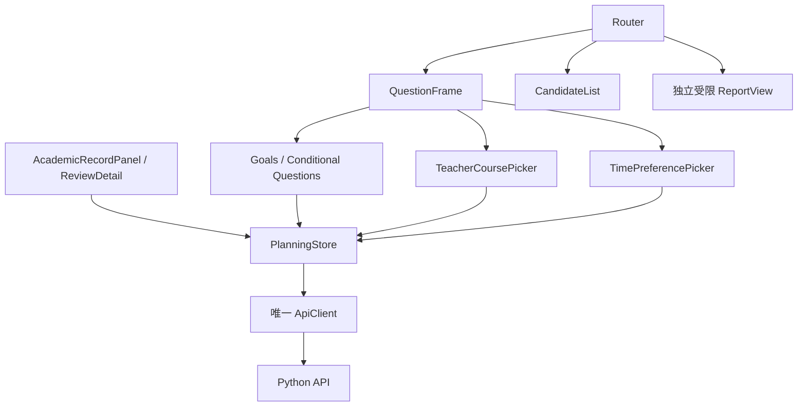
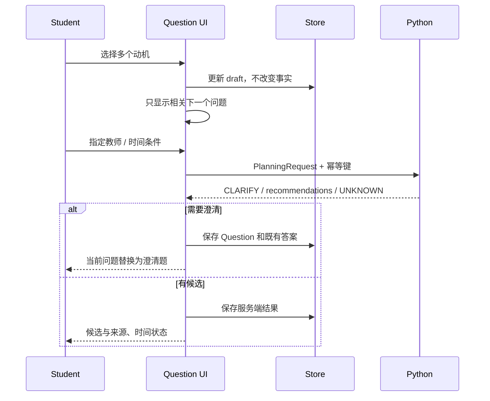
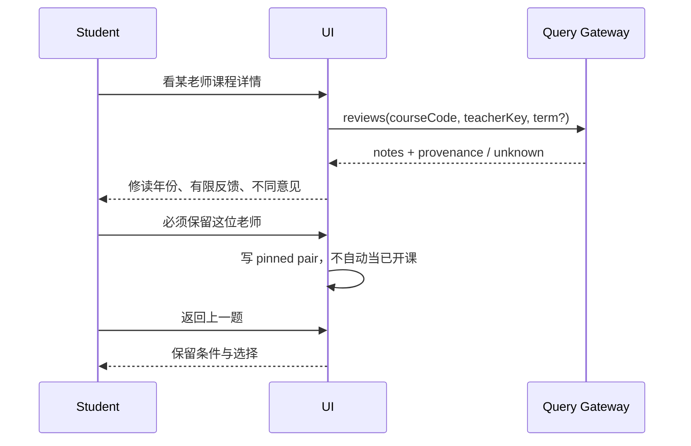

# E 模块：学生网页与老师报告（业务说明与 TRD）

负责人：**HelicasECoode42**。先读[团队总览](../15-team-baseline-and-batches.md)，再读本页业务功能，实施时查下半页接口与规则。当前 E1 学生目标引导页面与 E2 学业资料／核对／规划结果已实现（E2 尚未接真实 Python/Java）；教师比较（E-F3）、老师报告（E-F6）与澄清回填仍未实现。E1 范围和限制见[实现说明](../../web/README.md)、[本次实施方案](../20-e1-and-disclosure-implementation.md)与[Web任务核对记录](../21-web-task-status.md)；排期见[本期任务](../19-delivery-plan.md)。

## 先理解你要交出的完整模块

让学生顺利完成提供资料、表达目标、理解推荐和修改方案的过程；让老师通过独立入口查看评测与策略改进结果。

举例：学生只想降低工作量。页面应跳过职业问题，保留返回前的回答，展示课程评价的来源；推荐时间未知时说明待确认，学生改教师偏好后能看到新结果。

## 完整业务功能清单

| 功能编号 | 功能 | 具体需要完成什么 | 本期任务或后续期 |
| --- | --- | --- | --- |
| E-F1 | 查看和补充学业资料 | 已有本会话记录就读取，缺记录才补录；展示已满足、未满足和无法确认的培养要求。 | E2 |
| E-F2 | 引导学生表达需求 | 一次一问，每题都向全部学生展示且可留空；支持多目标、必须/偏好和优先级；返回保留答案。 | E1 |
| E-F3 | 比较课程与教师 | 搜索课程教师，查看来源/年份/维度/分歧，选择必须保留或优先考虑，并保留选择。 | E3 |
| E-F4 | 理解和调整推荐 | 展示候选、依据、冲突和未知；接住澄清问题，允许修改条件后重新推荐。 | E2 |
| E-F5 | 处理加载与失败 | 处理资料缺失、超时、会话失效、重试、重复点击和迟到结果，给出下一步。 | E1–E3；第七周回归 |
| E-F6 | 展示老师实验报告 | 独立受限页面显示真实基线、候选决策、质量成本和失败记录。 | 第六周细拆 |
| E-F7 | 保证页面可操作 | 桌面/窄屏/键盘可用，详情关闭后焦点返回，安全呈现评价和模型文本。 | E1–E3；第六周完善 |

上表是整个模块范围。A1/E2 等是[排期草案](../19-delivery-plan.md)的业务任务编号，尚不等于 GitHub Issue 编号；后续期功能届时拆任务。本期未覆盖的功能仍属于模块完整交付。

## 谁交给你、你交给谁

goat-yang 提供会话、查询、澄清和推荐接口；Java 事实通过 Python 后端到页面；amorfatiii 提供聚合报告。你将用户答案交 C，将页面流程交 D 验收，反馈缺失字段和显示问题。

## 你的责任边界

你拥有页面、路由、填写状态、请求适配和可访问性。学分/冲突由 Java 算，推荐由 Agent 生成，报告由 D 评分汇总。网页只调用 Python；老师报告需要后端权限支持。

## 整个模块怎样算完成

学生从资料到真实推荐/澄清/改条件可完成，普通与异常路径清楚，小屏键盘可用；老师报告显示实际运行结果，模拟与未知不会被展示为真实通过。 每项功能要有实现、实际消费者调用和正常/异常/未知的证据。权限、错误恢复等检查贯穿各功能，模拟与真实能力分别说明。

## 实现参考与技术约束

下面保留现有技术方案。业务功能是交付目标；组件、接口、函数与测试是实现这些功能的手段。字段以 contracts 为准，不在业务功能表里复制一套字段。

| 项 | 内容 |
| --- | --- |
| 责任 | HelicasECoode42，模块 E |
| 技术 | Vue 3/Vite/Router、Pinia 或会话 store、TypeScript、Fetch |
| 所有权 | web 页面/状态/API adapters、学生与老师两个路由、集成测试 |
| 输入 | 公共 DTO、C PlanningAnswer、B 经 Python 网关的事实、D RunReport |
| 输出 | 学生决策 UI、接口调用、明确 UNKNOWN 和来源、独立报告 |
| 状态 | E1 已有 Vue 3/Vite/TypeScript 页面、单一 API client、会话状态与动态问题路由；HTML 示例仍是独立交互原型，明确选择虚构资料后才展示虚构候选 |

### 1. 需求与边界

E-01 一次一问、每题都问且可留空、返回保留；E-02 已有关联记录不重复手填；E-03 多动机只表达在意什么与优先顺序，不路由题目，也不强迫职业；E-04 课程教师详情/必须与偏好；E-05 缺真实时间不称无冲突；E-06 工程报告不进学生主线。

HTML 与 [交接规范](../../demo/README.md) 为体验参考，固定示例候选不能复制成生产推荐逻辑。视觉基线是白底、640px 居中窄栏、PingFang SC/微软雅黑、`#18312b` 墨色、`#226c50` 绿色、`#65736d` 次级文字、`#f2f7f4` 浅底和 `#e1e8e3` 细线；小字号选项、短进度条、叶片标记、留白和文本式返回/绿色继续，不使用外围大圆角阴影卡片。学生页面不展示 Java/System/Harness/Prompt/Trace 等工程文案。

### 2. 组件结构与状态

store 分 inputDraft、record/audit、planningResult、requestState；表单 state 不等同后端事实。session bearer 只在内存，不写 localStorage/URL；刷新后提示建立新会话，不假装复用旧私人记录。到期或 401 会中止在途请求并清除会话凭据与培养方案上下文；当前页面内存里的学生答案保留，建立新会话后可继续，刷新会清空答案。

路由：/plan/questions/{questionId}、/plan/result、/records、/reports/{runId}。只有当前问题挂载；详情可用 dialog/drawer，键盘焦点回原入口。URL 记录问题标识，不放成绩/Prompt/token；退回保留内存答案。

### 3. 输入和调用约束

使用 [Python OpenAPI](../../contracts/planning.openapi.json)。浏览器不调 8080，不拿 serviceKey。正常入口建立会话→读本会话记录→audit；缺记录时 POST academic-records，明确完整性。成绩导入首版用结构化授权/虚构记录，不偷偷读取学校账号。

| UI 动作 | 接口 / 状态 |
| --- | --- |
| 读本会话学业记录 | `GET academic-records`，由会话派生归属，浏览器不提交 owner；`items` 为空表示尚无记录，是正常业务状态而不是错误，此时走补录入口 |
| 选路径/查课程 | curricula/courses，带 requestId，处理空与分页 |
| 查教师与评价 | teacher-course-options/reviews，current/historical/unknown 分开 |
| 看职业介绍 | career-directions，按 subjectTag，只展示有来源内容 |
| 发规划/改条件 | planning，bearer+新 Idempotency-Key，previousPlanId 可空 |
| 重试同一次网络丢答复 | 保持相同幂等键与内容，不能重复建新任务 |
| 看报告 | reports，只有有 admin 资格的独立路由 |

字段由共享 TS DTO/Schema 适配，不在每个组件定义同一接口的变体。未知 nullable 不转成 0、空字符串或“无冲突”。Backend status 与 requestState 分开。

### 4. 单问题路由时序

### 5. 状态和展示门禁

UI requestState=idle/loading/succeeded/failed；答复 decision 与 verification verdict/scope 是业务状态，不用一个 loading/error 字段包全部。

| 后端状态 | 文案与动作 |
| --- | --- |
| COURSE_ONLY / UNKNOWN | 课程建议，时间待确认，补资料入口 |
| SIMULATION + VALID | 模拟核验通过，不代表本学期课表 |
| REAL_TIMETABLE + VALID | 本次快照下核验结果，显示采集时间 |
| 答案 unknowns 含 FAKE_MODEL | 不得绿色通过；核验判决保持原样，只拦展示 |
| INVALID | 明确冲突/不满足项，调整条件 |
| ERROR/timeout | 重试同请求或重新修改，不伪造候选 |
| historical review | 往年主观反馈，本学期要求未确认 |

只有 scope REAL_TIMETABLE + verdict VALID + 对应来源资格才显示真实时间通过；答案级 unknowns 含 FAKE_MODEL 时仍然不得显示为真实通过。不能自己从无 violations 数组推断通过。记录 completeness 影响学分文案。

### 6. 安全、易用性与调试

不使用 v-html 渲染评价/模型文本；如需 Markdown 用禁 HTML 的安全渲染器并限制 URL scheme。链接 rel=noopener noreferrer；搜索/字段受长度限制。不能将 token 放 query、下载文件或调试截图。

loading 期间禁重复执行按钮但允许阅读/返回；响应绑定 task/request revision，较旧响应不能覆盖新条件。AbortController 只取消前端等待，不宣称后端模型已停止；迟到响应丢弃。

可访问性：label、button、visible focus、dialog focus trap/Escape、aria-live 状态；桌面与窄屏检查，不靠禁止缩放修布局。系统问题给可操作文案，不对学生展示 JSON/stack。

### 7. 验收与批次

排期见[本期任务](../19-delivery-plan.md)：先学生主线与教师详情，第六周独立老师报告与体验完善。

测：非职业目标不问岗位、多目标不互相覆盖、返回保存、详情关回原焦点、未知评价无假星级、教师硬锁不消失、缺班次无绿色通过、401过期、404越权、503超时、重复点击与迟到响应、小屏溢出。PR 附桌面/手机截图和交互结果；不能仅 node 语法检查声称视觉通过。

### 契约变更与完成标准

字段以 [contracts](../../contracts/README.md) 为真源，行为以 [公共契约](../04-infrastructure-workflow.md) 为准。提交提供者/消费者 DTO、正反例和受影响测试；Schema 破坏性变更升版本，不能边跑 Benchmark 边改。调试和提交要求见 [工程规范](../16-engineering-and-debugging.md)。

任务完成至少包含：实现目录、输入/输出、正常和失败证据、限制；fixture 不算真实接入，HTML 不算生产前端，手工改 Prompt 不算 RSI。每次 PR 使用仓库模板自查，接口 PR 由相邻模块复核。

### E1 当前实现与剩余交接

E1 页面已按合同实现显式真实服务模式下的匿名会话创建和已发布培养快照读取调用；Python 服务尚未实现，真实后端联调仍待完成。连接故障显示为可重试的系统问题，不转换为 fixture 成功。fixture 模式独立使用标明为合成的固定资料。会话 bearer 和问题答案都只在内存中；到期清除 bearer、会话和培养方案上下文，并取消在途请求，当前页面内存里的学生答案保留，刷新则全部清空。

学生可多选动机，并显式确认目标顺序。兴趣、职业、教师、时间、上课与考核偏好这些问题向所有学生展示，每题都可留空；动机不决定问哪些题，只表达在意什么与优先顺序。改动机不清空任何已填答案，请求构造也不按动机过滤已填字段。必须留空和尽量避开的时段在同一时间页用两个独立分组收集，可以同时存在；继续时会同时确认两组，且都可留空。目标动机和明确顺序按 `GoalIntent` 传递。

时间页以课表网格呈现：横轴星期、纵轴节次，学生直接点选格子，表示「周一第 1 节」这样的具体时段。页面用「必须避开 / 尽量避开」切换当前涂选的强度，两组选择同时保留，切换不清空另一组。整行（某节次每天）与整列（某星期整天）提供快捷选择，落到契约时仍归一为 `BLOCK_SECTION` 与 `BLOCK_DAY`。必须条件写入 `hardConstraints`，尽量避开写入 `softPreferences`；同一格子可以只属于其中一种强度。

必须避开不保证一定被满足：当某门必修课的唯一班次落在该时段，核验结果是 INVALID 并指出冲突的必修与时段，由学生选择放宽时段或推迟必修。页面不能把这种冲突显示为"已满足"，也不能自行删掉必修建议。

E1 上课与考核偏好向所有学生展示，可全部不选。字段映射如下；每个 `sourceText` 都是学生选择的意图说明，不是已核验课程事实。

| 页面选项 | `softPreferences.dimension` | `softPreferences.value` |
| --- | --- | --- |
| 给分反馈更友好 | `assessment.grading_feedback` | `prefer_friendly` |
| 尽量少签到 | `workload.attendance` | `lower_attendance` |
| 作业量少一些 | `workload.homework` | `lower_homework` |
| 少一些小组任务 | `assessment.group_tasks` | `fewer_group_tasks` |
| 少一些汇报和展示 | `assessment.presentations` | `fewer_presentations` |
| 尽量避开闭卷考试 | `assessment.closed_book_exam` | `avoid_closed_book` |

时间条件在请求中的字段含义如下。三种时间 kind 互斥，Schema 已用条件规则强制：`BLOCK_DAY` 的 `section` 必须为 `null`，`BLOCK_SECTION` 的 `dayOfWeek` 必须为 `null`，`BLOCK_SLOT` 两者都必须非空。

| 用户选择 | 合同表达 | `sourceText` 含义 |
| --- | --- | --- |
| 必须避开某格子 | `hardConstraints`: `BLOCK_SLOT`，`dayOfWeek` 与 `section` 都填写 | 必须避开该星期的该一节 |
| 必须避开整列 | `hardConstraints`: `BLOCK_DAY`，填写 `dayOfWeek`，`section` 为 `null` | 必须避开该星期整天 |
| 必须避开整行 | `hardConstraints`: `BLOCK_SECTION`，填写 `section`，`dayOfWeek` 为 `null` | 必须避开每个上课日的该节 |
| 尽量避开某格子 | `softPreferences`: `schedule.blocked_slot`，`value` 为 `"星期-节次"`，如 `"3-2"` | 尽量避开该星期的该一节 |
| 尽量避开整列 | `softPreferences`: `schedule.blocked_day`，`value` 为星期数字字符串 | 尽量避开该星期整天 |
| 尽量避开整行 | `softPreferences`: `schedule.blocked_section`，`value` 为节次数字字符串 | 尽量避开每个上课日的该节 |

Schema 目前只校验软偏好字段为非空字符串，Python/Agent 消费端还未实现或确认上述映射的行为效果。前端只表达学生意图并构造契约请求，不能承诺推荐已经理解或遵循这些偏好，也不保证高分、少签到或某种考核方式。

确认页会回看所选目标和明确顺序、课程考核偏好、兴趣/职业补充、教师选择状态、必须和尽量避开的时段，以及培养方案来源和学业记录状态；真实模式可展开说明缺少学业记录的原因。当前合同只有 `GET /academic-records/{recordId}`，没有列出本会话学业记录的接口；创建记录虽然存在，但 E1 没有收集/保存记录的完整入口。因此真实模式在学业记录缺失时停止请求交接，不生成编号，也不提交 `/planning`。HTTP 真实模式过滤 `SYNTHETIC` 培养方案，builder 也会拒绝合成或未核验来源进入 `REAL` 请求；没有真实、已核验的培养方案和真实学业记录就不会生成 REAL 请求。`buildPlanningRequest` 是 E1→E2 的类型化边界，并直接校验 `contracts/schemas/domain.schema.json`；完整确认的优先顺序也是交接条件。fixture 的有效请求标记为 `SIMULATION`，且仅用于演示，不产生推荐结果。

独立 HTML 原型会在优先级确认后增加资料核对步骤。原型没有真实资料入口；只有用户明确确认“只想查看虚构演示”后，才显示固定的虚构候选，真实规划操作不可用。Vue E1 的 fixture 模式由启动配置显式选择，也只整理示例请求，不生成候选或真实推荐。

选择指定教师会显示后续交接说明。E1 不显示或创建虚构教师；E3 提供课程绑定的真实选项后，才能写 `pinnedTeacherCoursePairs` 的 `MUST` 或 `PREFER`。Web 依赖与固定脚本见 [web/README](../../web/README.md)。
